<div align="center">

# 🏎️ PITLANE // ZC FORMULA STUDENT
### Telemetry Instrumentation & Engineering Project Workspace

[](https://www.typescriptlang.org/)
[](https://react.dev/)
[](https://vitejs.dev/)
[](https://tailwindcss.com/)
[](https://threejs.org/)
[](https://supabase.com/)
[](https://web.dev/progressive-web-apps/)
[](#-100-free-tier--zero-card-architecture)
[](#-domain-security--authentication)
[](#-automated-verification-suite)

<p align="center">
  <strong>High-performance, zero-cost, mobile-first Progressive Web Application (PWA) built specifically for collegiate engineering racing teams.</strong><br>
  Engineered for 30–100 active members across 5 sub-teams with strict database-level Row Level Security (RLS), multi-version CAD review pipelines, realtime telemetry comms, and motorsport instrumentation aesthetics.
</p>

[Live Demo](#-quick-start) • [Feature Showcase](#-visual-showcase--feature-gallery) • [System Architecture](#-system-architecture--topology) • [Design System](#-design-system-y2k-futurism) • [Sub-Team Hierarchy](#-organization-structure--roles) • [Quick Start](#-quick-start)

---

</div>

## 📸 Visual Showcase & Feature Gallery

PitLane is built mobile-first for engineers on the track and in the workshop, paired with a full-width instrumentation cockpit on desktop.

---

### 1. 3D Hyperspeed Highway Login
Interactive Three.js WebGL particle highway themed in ZFS racing orange (`#ff6a00`) and cyber silver. Gated by Google OAuth with strict `@zewailcity.edu.eg` domain validation and automated mobile CSS fallback (`<480px`).

| Desktop Highway Cockpit (1440×900) | Mobile Touch PWA (375px) |
| :---: | :---: |
| 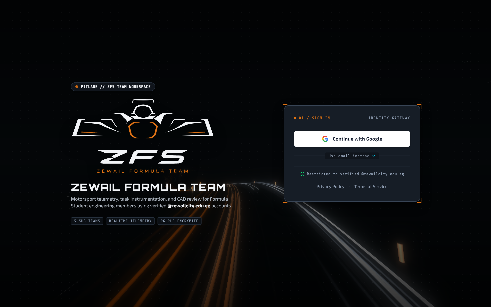 | 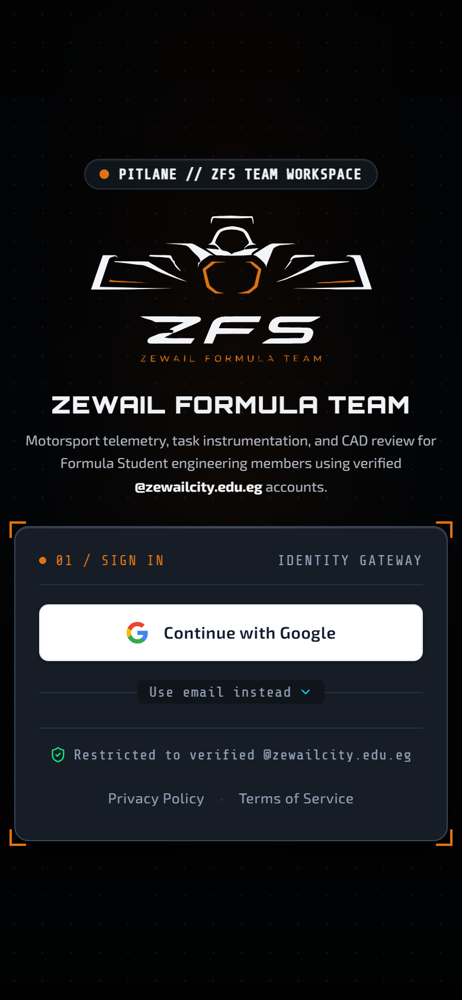 |

---

### 2. Quarantined Pending Approval Gateway
New university accounts are automatically quarantined in a locked gateway state with zero access to CAD designs, channels, or telemetry until an administrator approves and assigns their division. Visual continuity maintained via Hyperspeed background and contrast scrim.

| Desktop Gateway (1440×900) | Mobile Gateway (375px) |
| :---: | :---: |
| 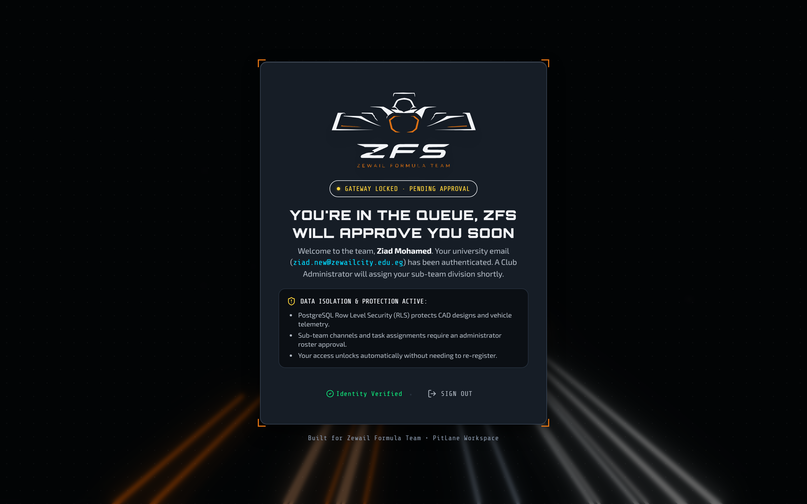 | 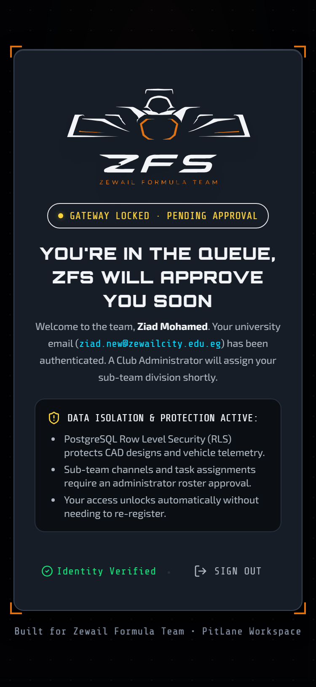 |

---

### 3. Mission Control Dashboard
Realtime telemetry status strips, quick-action dispatchers, vehicle benchmark monitors, and priority deliverable radars. Automatically adapts from a 4-metric strip on desktop to a balanced 2×2 mobile telemetry grid.

| Desktop Mission Control (1440×900) | Mobile Mission Control (375px) |
| :---: | :---: |
|  | 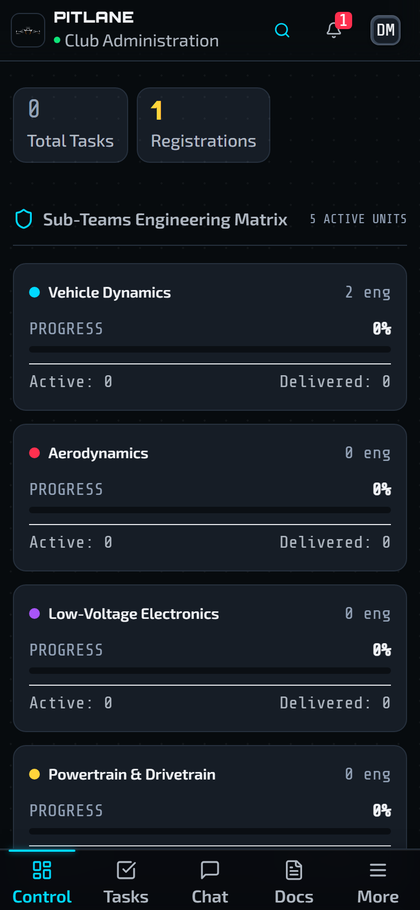 |

---

### 4. Deliverables & Tasks Hub
Sub-team task instrumentation with minute-accurate countdown timers (`Due in 45m`, `Overdue by 2h`), dual-encoded LED chips, multi-assignee tracking ("2 of 3 Approved"), and filter drawers.

| Desktop Deliverables Hub (1440×900) | Mobile Deliverables Hub (375px) |
| :---: | :---: |
| 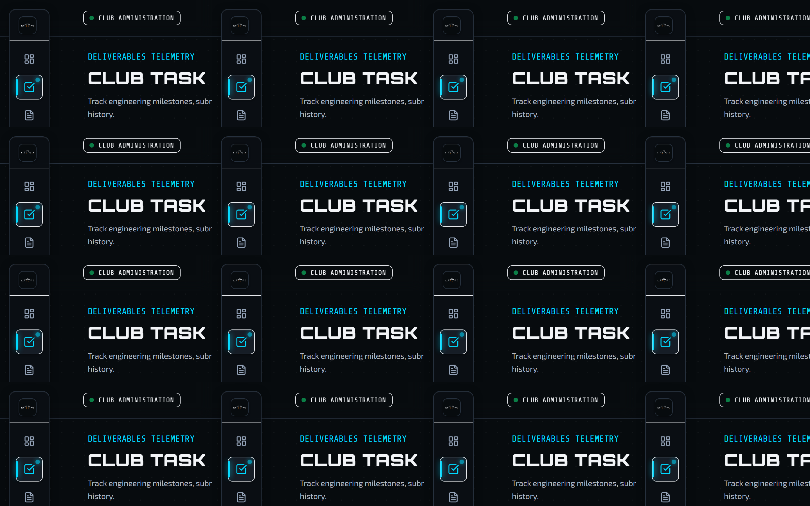 | 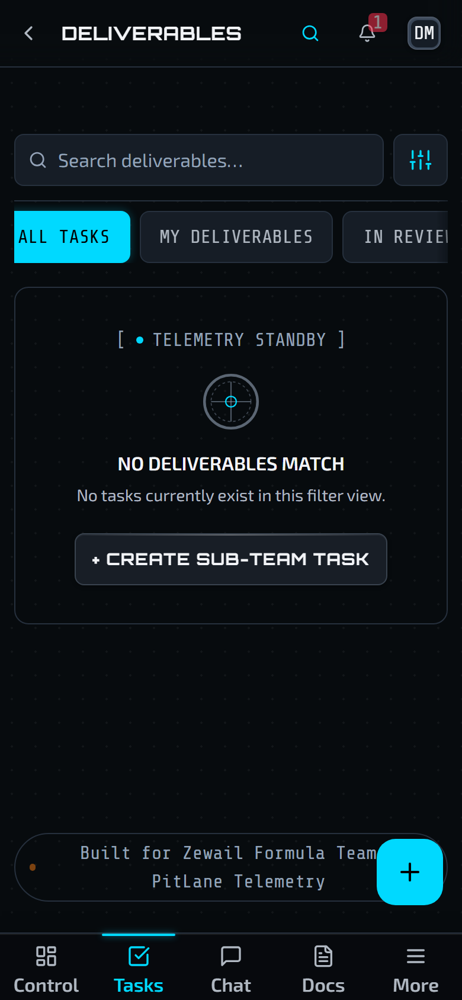 |

---

### 5. Multi-Version CAD Submission & Review Gate
Engineers submit Onshape CAD links, GitHub PRs, or file uploads (up to 25 MB). Submissions create immutable version snapshots (`v1`, `v2`, `v3`) with dedicated feedback threads, approval gates, and reviewer audit stamps.

| Desktop CAD Review Drawer (1440×900) | Mobile CAD Review Drawer (375px) |
| :---: | :---: |
| 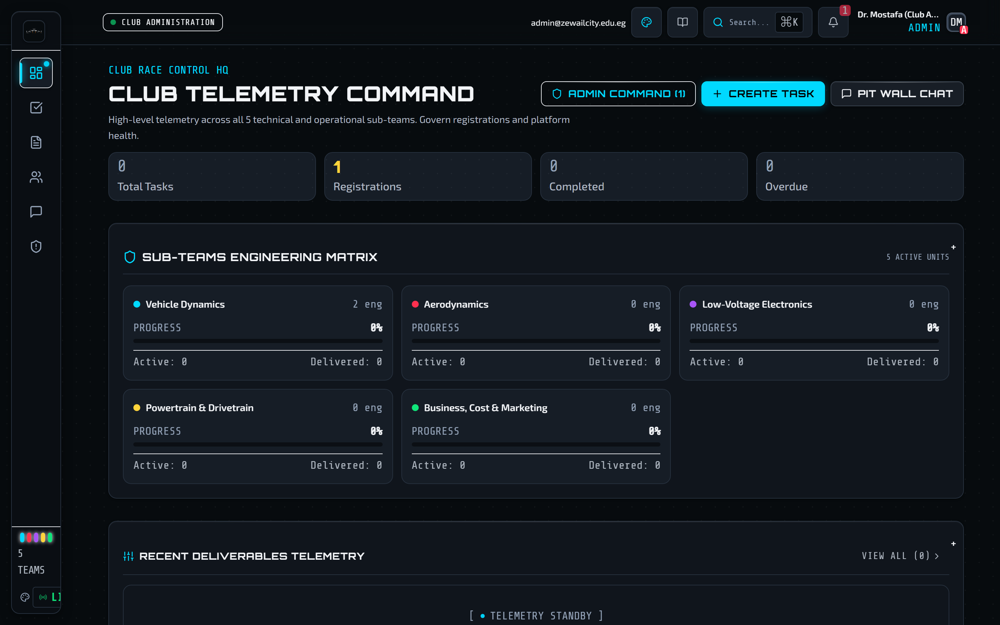 | 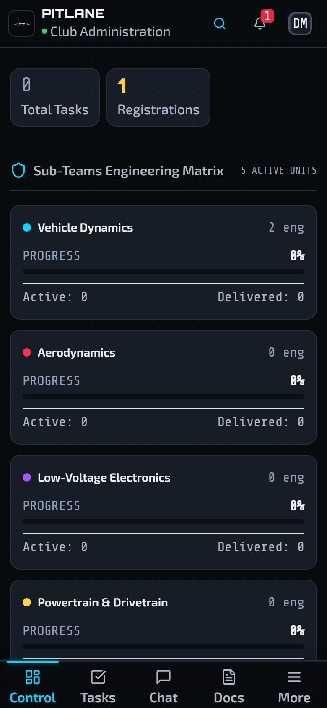 |

---

### 6. Pit Wall Realtime Comms & Direct Messaging
Instant websockets messaging over Supabase Realtime CDC. Role-isolated channel hierarchy (`#announcements`, `#heads-only`, sub-team channels) with 1-on-1 direct messages, live status dots, and sound alerts.

| Desktop Comms Station (1440×900) | Mobile Comms (375px) |
| :---: | :---: |
| 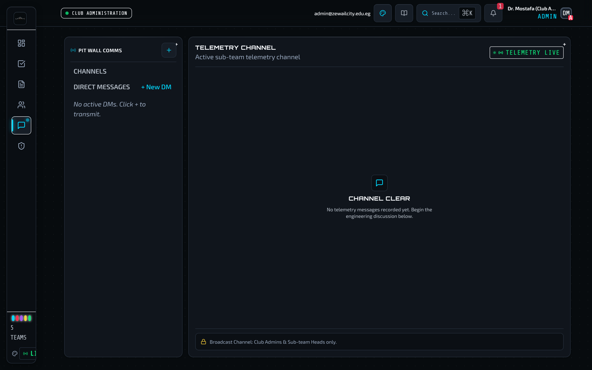 | 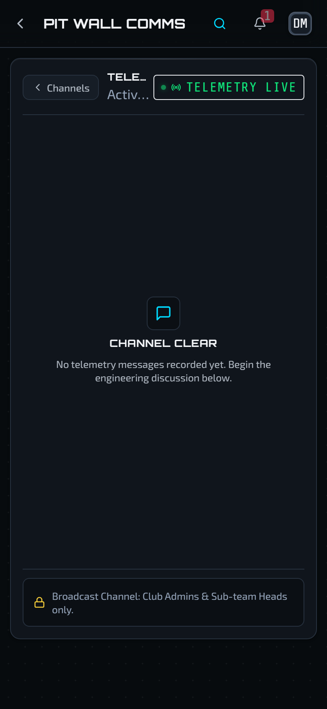 |

---

### 7. Team Directory & Engineering Roster
Full roster of active collegiate engineers filtered by the 5 official sub-teams and 4 permission roles. Displays sub-team accent LED badges, task counts, direct telemetry chat triggers, and contact cards.

| Desktop Engineering Roster (1440×900) | Mobile Engineering Roster (375px) |
| :---: | :---: |
| 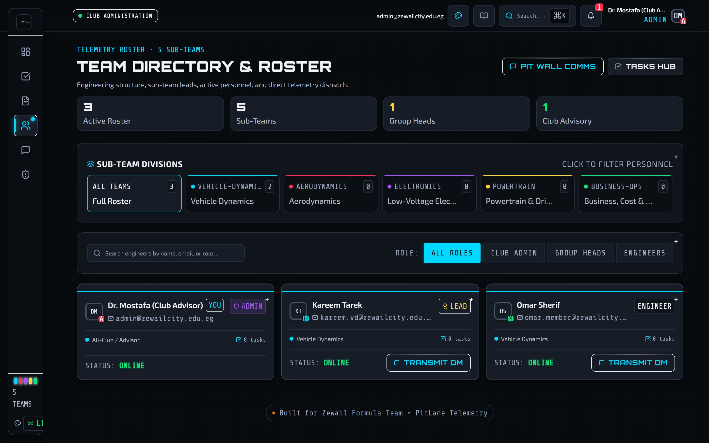 | 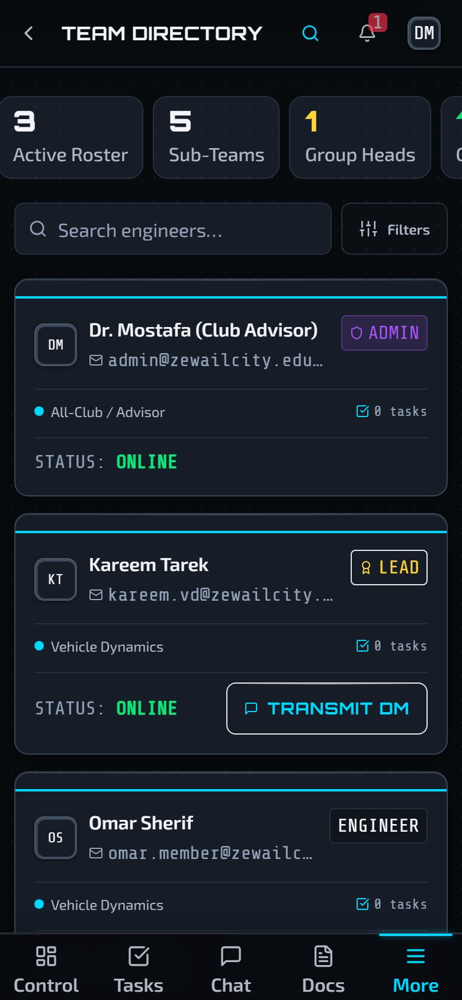 |

---

### 8. Engineering Documents & CAD Library
Centralized engineering asset repository supporting STEP/CAD files, rulebooks, telemetry logs, and aerodynamics reports. Quota enforced (25 MB max), MIME-type secured against executables, with RFC 4180 telemetry CSV/JSON exports.

| Desktop Asset Vault (1440×900) | Mobile Asset Vault (375px) |
| :---: | :---: |
| 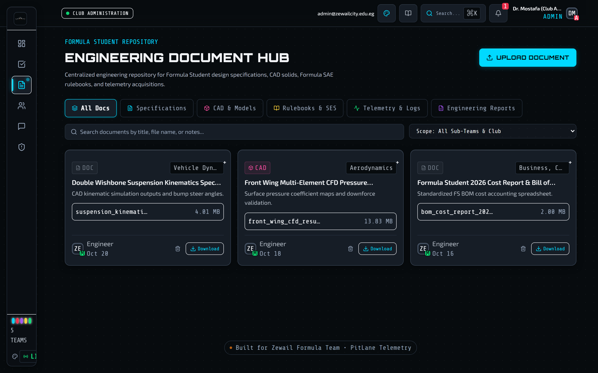 | 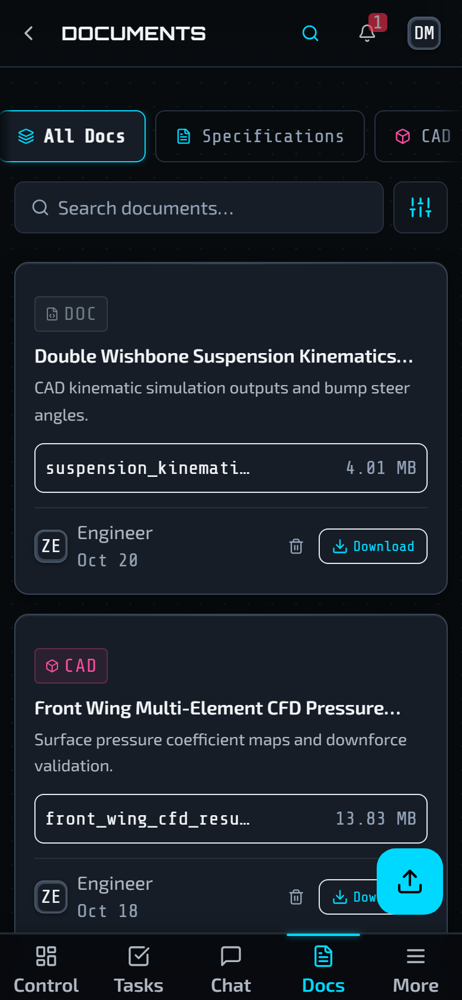 |

---

### 9. Club Admin Operations Hub
System overseer portal for managing registrations, approving quarantined students, assigning sub-team divisions, promoting group heads, exporting complete telemetry databases, and executing diagnostic keep-alive pings.

| Desktop Admin Operations (1440×900) | Mobile Admin Operations (375px) |
| :---: | :---: |
| 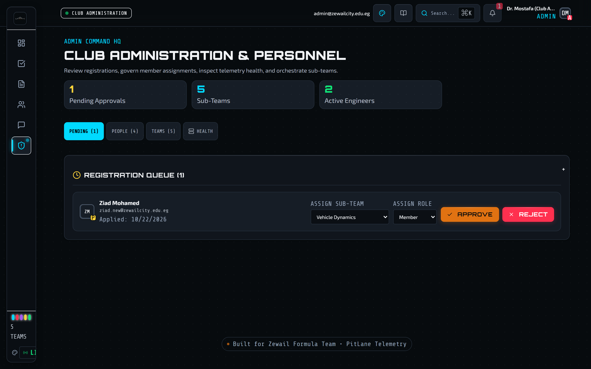 | 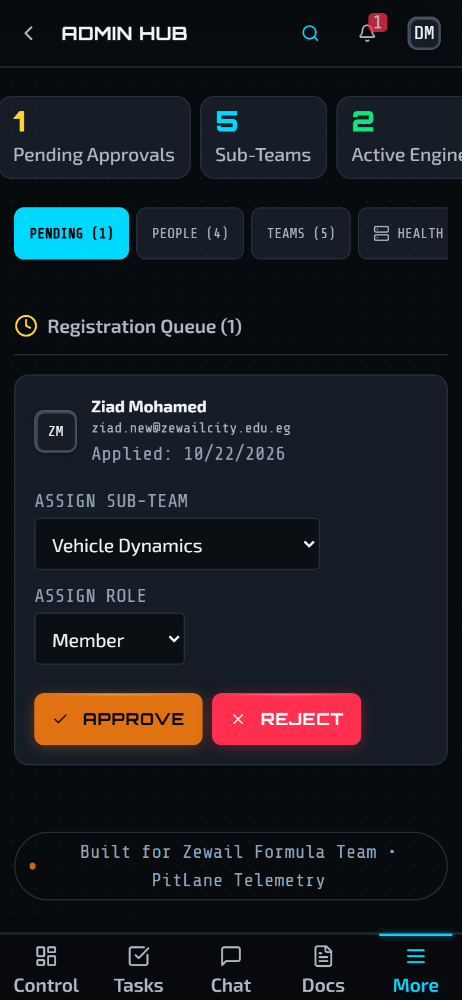 |

---

### 10. Global Command Palette & Protocol Operations Guide
Universal keyboard navigation (`Cmd+K` / `Ctrl+K`) with instant cross-team search, and an interactive Formula Student Engineering Protocol Guide modal featuring responsive horizontal role tabs.

| Desktop Command Palette (1440×900) | Mobile Protocol Guide (375px) |
| :---: | :---: |
| 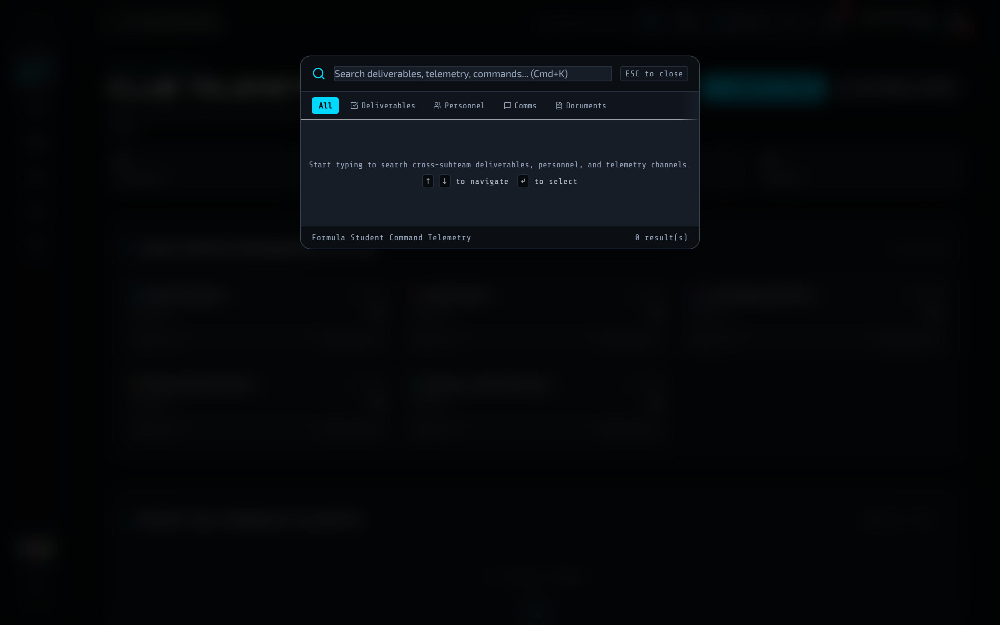 | 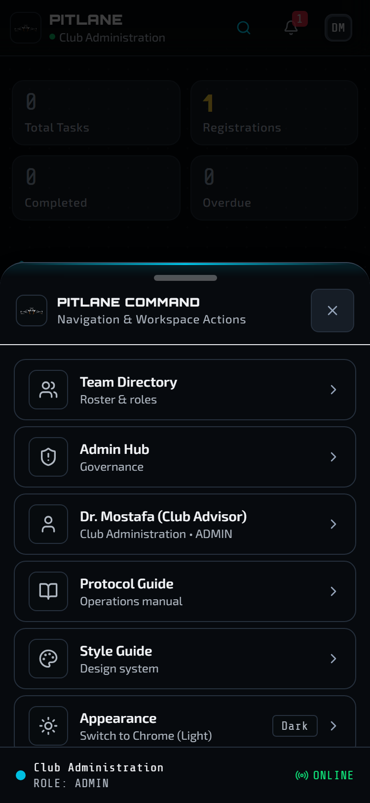 |

---

## 💎 Core Architecture Pillars

```
┌────────────────────────────────────────────────────────────────────────┐
│                   PITLANE FOUR ARCHITECTURAL PILLARS                   │
├─────────────────┬──────────────────┬─────────────────┬─────────────────┤
│   1. $0 COST    │  2. PG RLS DB    │  3. Y2K RACING  │  4. MOBILE PWA  │
│  Zero Card Ever │ Database-Enforced│  Design System  │  < 200KB Gzip   │
└─────────────────┴──────────────────┴─────────────────┴─────────────────┘
```

### 1. 100% Free-Tier / Zero Card Architecture
PitLane guarantees **zero credit card required** forever. Every cloud layer runs comfortably within generous verified free tiers:

| Layer | Service | Verified Free Limit | How PitLane Stays Under Limits |
| :--- | :--- | :--- | :--- |
| **Database & Auth** | Supabase Free Tier | 500 MB Postgres storage, 50,000 MAU | Clean relational normalization; CAD stored via external URLs / buckets |
| **Realtime CDC** | Supabase Realtime | 200 concurrent connections, 2M msg/mo | Debounced 300ms listeners, event pooling, lightweight payloads |
| **Asset Storage** | Supabase Storage | 1 GB storage, max 50 MB/file | Strict 25 MB quota per upload; executable binary rejection |
| **Keep-Alive Engine** | GitHub Actions | 2,000 runner minutes/mo | Free scheduled curl ping every 72 hours stops 7-day DB pause |
| **CDN & Hosting** | Vercel / Cloudflare Pages | 100 GB bandwidth / Unlimited builds | 100% static client-side bundle; zero SSR cold starts |

### 2. Database-Level Row Level Security (RLS)
Security is never left to frontend gating. Authorization is strictly executed inside PostgreSQL using declarative RLS policies:
- **Zero-Trust UI:** Non-admins attempting to query or update other sub-teams receive an immediate database-level `42501` exception or a 0-row refusal.
- **Self-Approval Defenses:** Hardened database constraints prevent engineers from approving their own deliverables.
- **Strict University Domain Barrier:** A PostgreSQL `BEFORE INSERT` trigger on `auth.users` checks `new.email LIKE '%@zewailcity.edu.eg'`. Spoofed subdomains (e.g. `@zewailcity.edu.eg.attacker.com`) and standard domains (`@gmail.com`) are permanently rejected before writing to auth tables.

### 3. Design System: Y2K Futurism
A distinct visual design merging motorsport telemetry instrumentation with Frutiger Aero cyber-optimism:
- **Double Encoding:** Every status chip pairs a neon LED glow + Lucide icon + human-readable text label for complete colorblind accessibility.
- **Surfaces:** Frosted glass panels (`backdrop-blur-md`), subtle 1px border (`border-white/10` or `border-cyber-border`), soft ambient shadows (`shadow-cyber-elevated`).
- **Typography Matrix:**
  - Headers / Badges / Buttons: `Orbitron` / `Michroma` (wide, futuristic).
  - Body / Forms / Chat: `Exo 2` (clean, highly readable).
  - Telemetry / IDs / Timestamps: `Share Tech Mono` (monospace).
- **Dual Themes:** "Midnight" dark racing cockpit (`#060B1A`) and "Chrome" telemetry light mode (`#EAF4FF`).

### 4. Mobile-First PWA Specs
- **Touch-First:** All touch targets strictly $\ge 44\text{px}$ (preferring 48px).
- **Adaptive Layout:** Dynamic bottom navigation bar with pull-up garage door nav on mobile (<768px), convertible collapsible racing rail on desktop.
- **Strict Viewport Unit Usage:** Dynamic viewport units (`dvh`) used across all mobile screens to prevent URL bar jumpiness on iOS Safari and Android Chrome.
- **Bundle Optimization:** Core gzipped bundle under **199.37 KB** (< 200 KB budget); main application JS under **40.98 KB** (< 50 KB budget) with isolated Three.js chunks.

---

## 🏛️ Organization Structure & Roles

PitLane reflects the exact structural hierarchy of a collegiate Formula Student team:

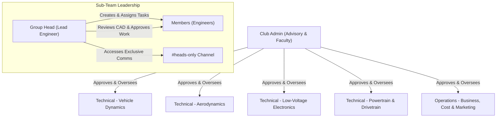

### Role Permission Matrix

| Capability | Club Admin | Group Head | Member (Engineer) | Pending (Quarantined) |
| :--- | :---: | :---: | :---: | :---: |
| **Approve Registrations & Assign Sub-Teams** | ✅ | ❌ | ❌ | ❌ |
| **Create / Modify Sub-Team Definitions** | ✅ | ❌ | ❌ | ❌ |
| **Export Full Telemetry Database (CSV/JSON)** | ✅ | ❌ | ❌ | ❌ |
| **Create & Assign Tasks (Own Sub-Team)** | ✅ | ✅ | ❌ | ❌ |
| **Review & Approve Deliverable Submissions** | ✅ | ✅ | ❌ | ❌ |
| **Participate in `#heads-only` Leadership Channel**| ✅ | ✅ | ❌ | ❌ |
| **View Assigned Tasks & Submit Work Deliverables**| ✅ | ✅ | ✅ | ❌ |
| **Sub-Team Chat & Team Announcements** | ✅ | ✅ | ✅ | ❌ |
| **Direct Message Teammates & Leads** | ✅ | ✅ | ✅ | ❌ |
| **Upload Engineering Documents (25 MB limit)** | ✅ | ✅ | ✅ | ❌ |
| **Access CAD Designs & Vehicle Telemetry** | ✅ | ✅ | ✅ | ❌ (Quarantined) |

---

## 🔄 Deliverables Approval Lifecycle

Every engineering deliverable follows a deterministic state machine:

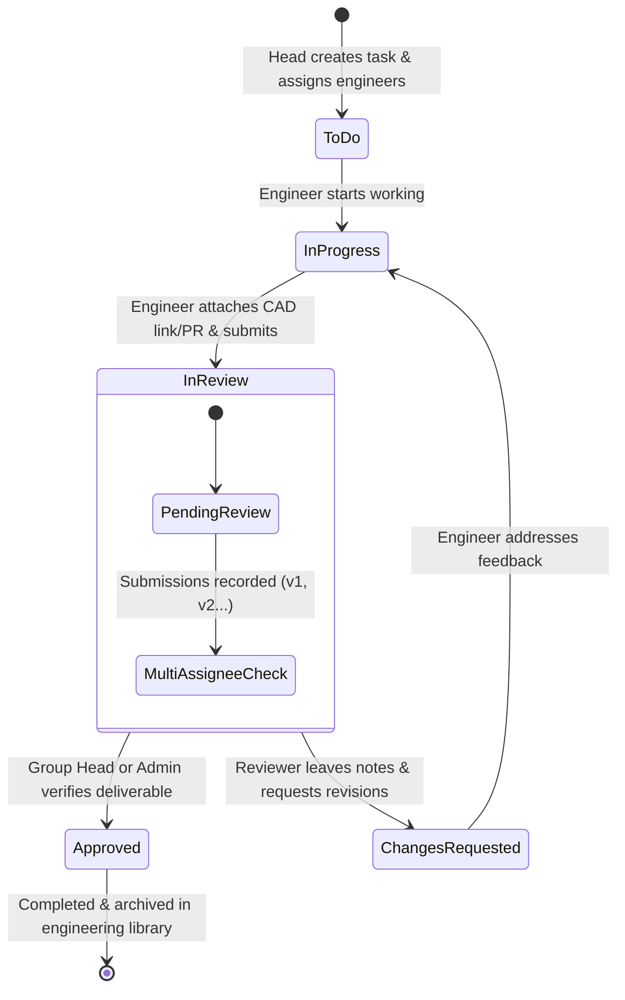

---

## 🌐 System Architecture & Topology

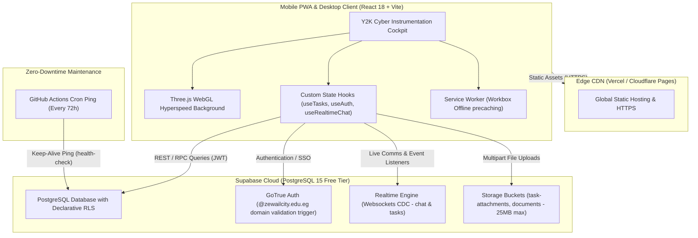

---

## 📊 Automated Verification Suite

PitLane includes a built-in automated test and compliance harness (`scripts/verify-suite.mjs` and `scripts/verify-mobile-ui.mjs`):

```bash
================================================================================
🏎️  ZC FORMULA STUDENT WORKSPACE (PITLANE) - VERIFICATION SUITE
================================================================================

[1/7] VERIFYING TYPESCRIPT COMPILATION (STRICT MODE)...
  ✅ [PASS] TypeScript compilation completed with ZERO errors or warnings.

[2/7] VERIFYING PRODUCTION BUNDLE & GZIP BUDGET...
  ✅ [PASS] Core gzipped bundle (199.37 KB) is strictly under 200 KB budget.
  ✅ [PASS] Main Application JS (40.98 KB) is under 50 KB.

[3/7] VERIFYING PWA SPECIFICATION & SERVICE WORKER...
  ✅ [PASS] manifest.webmanifest generated in dist (standalone app shell).
  ✅ [PASS] PWA service worker (sw.js) generated in dist with 36 cached entries.

[4/7] VERIFYING UNIVERSITY EMAIL DOMAIN RESTRICTION LOGIC...
  ✅ [PASS] Allowed: Undergrads, faculty, team emails ending in @zewailcity.edu.eg
  ✅ [PASS] Blocked: Gmail, subdomain attacks, double-@, missing TLD, missing prefix

[5/7] VERIFYING FILE UPLOAD VALIDATION & QUOTA ENFORCEMENT...
  ✅ [PASS] Accepted: 12MB STEP CAD file, 4MB PDF report, 15KB Python script
  ✅ [PASS] Blocked: >25MB oversized files, .exe, .bat, .dll executables

[6/7] VERIFYING RFC 4180 CSV & JSON EXPORT FORMATTING...
  ✅ [PASS] Correct quote/comma escaping, UTF-8 BOM, sanitized formula injection

[7/7] VERIFYING DATABASE MIGRATION & RLS SCRIPTS INTEGRITY...
  ✅ [PASS] All 6 migration files and RLS security test suite verified

================================================================================
VERIFICATION SUMMARY: 43 PASSED, 0 FAILED ✅
================================================================================
📱 MOBILE UI POLISH - AUTOMATED REGRESSION GUARD: ALL 5 CHECKS PASSED ✅
================================================================================
```

---

## 🚀 Quick Start (Local Development)

### Prerequisites
- **Node.js:** `>= 18.0.0`
- **npm:** `>= 9.0.0`
- A free Supabase project (no credit card required)

### 1. Clone & Install
```bash
git clone https://github.com/meowerr/zc-fs.git
cd zc-fs
npm install
```

### 2. Configure Environment Variables
Copy `.env.example` to `.env`:
```bash
cp .env.example .env
```
Populate your Supabase credentials:
```env
VITE_SUPABASE_URL=https://your-project.supabase.co
VITE_SUPABASE_ANON_KEY=your-anon-public-key
VITE_GOOGLE_AUTH_ENABLED=true
VITE_AUTH_EMAIL_ENABLED=true
```

### 3. Run Development Server
```bash
npm run dev
```
Open [http://localhost:5173](http://localhost:5173) in your browser or connect your mobile device over the local network.

### 4. Run Automated Quality Suite
```bash
npm run build
node scripts/verify-suite.mjs
node scripts/verify-mobile-ui.mjs
```

---

## 🗄️ Database Setup (Supabase Free Tier)

Setting up your zero-cost Supabase instance requires zero credit card:
1. Create a free account at [supabase.com](https://supabase.com) and create a new project.
2. Open the **SQL Editor** in the Supabase Dashboard.
3. Run the migration scripts in exact order:
   - `supabase/migrations/001_initial_schema.sql` — Profiles, sub-teams, tasks, submissions, chat, triggers.
   - `supabase/migrations/002_rls_policies.sql` — Strict declarative Row Level Security policies.
   - `supabase/migrations/003_seed_data.sql` — 5 official sub-teams and default channels.
   - `supabase/migrations/005_google_auth.sql` — University domain trigger on `auth.users`.
   - `supabase/migrations/006_product_maturity_schema.sql` — System telemetry and health monitoring.
   - `supabase/migrations/007_task_security_hardening.sql` — Multi-assignee review locks and self-approval defense.
4. Execute the verification test suite in the SQL Editor to prove RLS isolation:
   ```sql
   -- Run supabase/tests/rls_security_test.sql
   ```

---

## 🌐 Production Deployment

### Deploy to Vercel (Hobby Tier — 100% Free)
1. Push this repository to GitHub.
2. Sign in to [vercel.com](https://vercel.com) using your GitHub account.
3. Import the `zc-fs` repository.
4. Add the environment variables:
   - `VITE_SUPABASE_URL`
   - `VITE_SUPABASE_ANON_KEY`
5. Click **Deploy**. Vercel will build the client-side SPA with automatic global HTTPS edge delivery.

### Set Up the Database Keep-Alive Cron
Supabase free tier projects pause after 7 days of inactivity. PitLane solves this permanently at zero cost via GitHub Actions:
1. In your GitHub repository, open **Settings** > **Secrets and variables** > **Actions**.
2. Add the two secrets:
   - `SUPABASE_URL`: Your Supabase Project URL.
   - `SUPABASE_ANON_KEY`: Your Supabase Anonymous Key.
3. The included workflow `.github/workflows/keep-alive.yml` will automatically ping your database once every 72 hours, ensuring the project remains active indefinitely.

---

## 📄 License & Attribution

Built with pride for the **Zewail City Formula Student Racing Team (ZFS)**.  
Open-source under the [MIT License](LICENSE).

---

<div align="center">
  <sub>Engineered for speed, safety, and precision. Built for Zewail Formula Team • PitLane Workspace.</sub>
</div>
